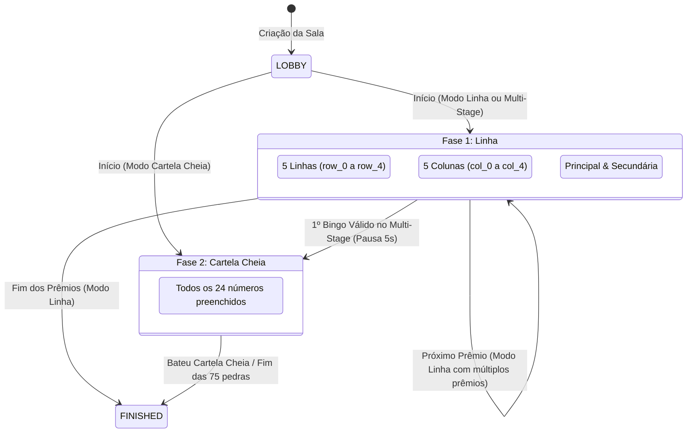
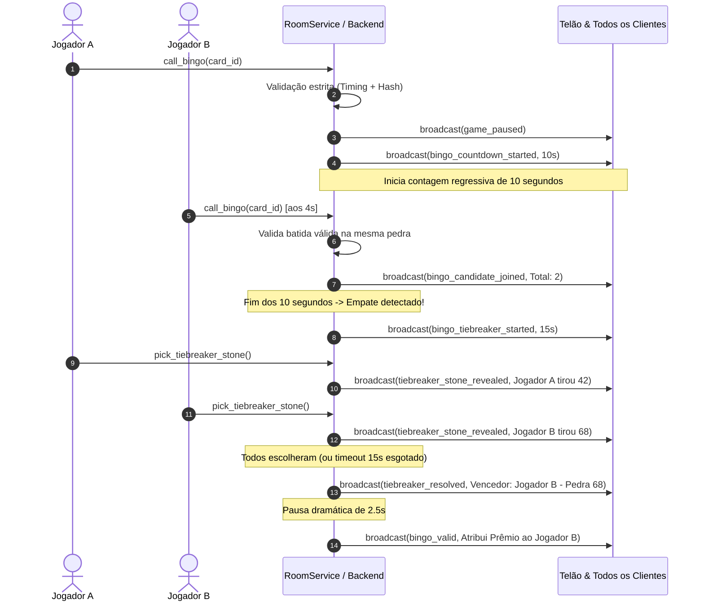

# 🎲 Regras de Negócio & Game Engine — Bingo Royale 75

Este documento descreve detalhadamente todas as regras de negócio, mecânicas de validação, critérios de vitória, fluxo de desempate e governança de gerenciamento implementadas no **Bingo Royale 75**.

---

## 1. Fundamentos do Bingo Americano (75 Bolas)

O Bingo Royale opera sob a regra clássica de 75 bolas numeradas de 1 a 75, distribuídas uniformemente em 5 colunas correspondentes às letras da palavra **B-I-N-G-O**:

| Coluna | Faixa Numérica | Quantidade por Cartela | Espaço Especial |
| :---: | :---: | :---: | :---: |
| **B** | 1 a 15 | 5 números aleatórios | — |
| **I** | 16 a 30 | 5 números aleatórios | — |
| **N** | 31 a 45 | 4 números aleatórios | **Centro FREE (Livre)** pré-marcado |
| **G** | 46 a 60 | 5 números aleatórios | — |
| **O** | 61 a 75 | 5 números aleatórios | — |

### 1.1 Geração e Criptografia das Cartelas
- Cada cartela gerada é uma matriz 5x5 composta por instâncias de `BingoCell`.
- O espaço central (linha 2, coluna 2) é configurado como `is_free=True` e `marked=True`.
- **Integridade Criptográfica (Anti-Fraude):** No momento da criação no servidor, calcula-se um hash HMAC-SHA256 combinando o identificador da cartela (`card_id`), a sequência ordenada de números e uma chave secreta (`SECRET_KEY`). Qualquer cartela adulterada pelo cliente é sumariamente rejeitada pelo backend.

---

## 2. Modos de Jogo e Critérios de Vitória

O sistema suporta três modos de apuração de vitória (`WinCondition`):



### 2.1 Padrões de Linha Elegíveis (Modo Linha / Fase 1)
1. **5 Linhas Horizontais:** Linhas 1 a 5 (`row_0` a `row_4`).
2. **5 Colunas Verticais:** Colunas B, I, N, G, O (`col_0` a `col_4`).
3. **Diagonal Principal:** Superior esquerda para inferior direita (`(0,0)`, `(1,1)`, `(2,2 FREE)`, `(3,3)`, `(4,4)`).
4. **Diagonal Secundária:** Superior direita para inferior esquerda (`(0,4)`, `(1,3)`, `(2,2 FREE)`, `(3,1)`, `(4,0)`).

### 2.2 Cartela Cheia / Blackout (Modo Blackout / Fase 2)
- Requer a marcação de todas as 24 células numeradas da cartela (o centro FREE já está computado).

### 2.3 Progressão Multi-Stage (`multi_stage`)
1. A partida começa automaticamente exigindo **Linha**.
2. Quando o primeiro jogador bate Linha e o prêmio correspondente é conferido, o backend avisa os jogadores via evento `bingo_valid`, introduz uma pausa comemorativa de 5 segundos e comuta automaticamente a fase para **Cartela Cheia** (`BLACKOUT`).
3. As cartelas mantêm as marcações já feitas e os sorteios prosseguem até o preenchimento total.

---

## 3. Regra Crítica do Tempo (Timing de Batida)

> [!IMPORTANT]
> **O BINGO DEVE SER CANTADO ANTES DO PRÓXIMO NÚMERO SER SORTEADO!**

Em bingos tradicionais, o jogador perde o direito ao prêmio se esquecer de gritar bingo e o locutor tirar outra pedra. No Bingo Royale 75, essa regra é implementada de forma rigorosa no backend:

1. Quando o jogador aciona o botão **"BINGO!"**, o motor do servidor (`check_card_victory_detailed`) recebe a cartela, a lista completa de pedras sorteadas e a **última pedra sorteada (`last_drawn_ball`)**.
2. O servidor identifica qual padrão foi completado.
3. Se a última pedra sorteada **NÃO** fizer parte do padrão vitorioso (ou seja, o padrão já havia se completado em rodadas anteriores e o jogador demorou para clicar), a vitória é **rejeitada**:
   ```json
   {
     "is_winner": false,
     "rejection_reason": "Bingo expirado: o número que completou sua vitória foi sorteado em uma rodada anterior e o próximo número já foi chamado!"
   }
   ```
4. Se a última pedra sorteada for de fato uma das pedras que fechou a linha/cartela, o bingo é considerado **tempestivo e válido**.

---

## 4. Prevenção de Prêmios Duplicados e Risco Visual

Para garantir justiça e clareza visual:
- Cada padrão premiado (`pattern_id`, ex: `row_1`, `diag_main`) fica registrado no histórico da cartela em `claimed_patterns`.
- Uma cartela **não pode ser premiada duas vezes com a mesma linha**.
- Quando um bingo é validado, o servidor envia `winning_cells` com as coordenadas exatas da linha vencedora.
- No frontend, o componente `BingoCard` renderiza um traço comemorativo dourado translúcido com gradiente e animação de pulso diretamente sobre a linha completada, marcando-a de forma permanente no display.

---

## 5. Janela de Contestação (10 Segundos) & Showdown de Desempate

Quando um jogador canta Bingo, pode acontecer de outro jogador ter completado sua linha com a mesma pedra simultaneamente. O Bingo Royale possui um protocolo de contestação e desempate automático para garantir que apenas **um** jogador receba cada prêmio individual:



### 5.1 Regras do Showdown da Pedra Mais Alta:
1. **Janela de 10 Segundos:** Aberta no momento em que o primeiro jogador canta bingo válido. Se a contagem terminar com apenas 1 candidato, o prêmio é concedido imediatamente.
2. **Empate:** Havendo 2 ou mais candidatos na mesma pedra, inicia-se o minigame de desempate.
3. **Pedras Misteriosas Únicas:** O servidor gera um conjunto de pedras numeradas de 1 a 75 sem repetição. Cada jogador escolhe uma pedra misteriosa virada para baixo.
4. **Sem Duplicidade de Pedras:** Dois jogadores nunca recebem a mesma pedra no sorteio de desempate.
5. **Timeout de 15 Segundos:** Caso algum jogador não selecione sua pedra no tempo limite, o backend efetua uma escolha automática em seu nome (`auto_picked: True`).
6. **Critério de Vitória:** O jogador que revelar a **maior pedra numérica** vence a disputa e leva o prêmio.

---

## 6. Sistema Dinâmico de Prêmios

- Cada sala permite cadastrar uma quantidade livre de prêmios por rodada (ex: "1º Prêmio: Cafeteira Elétrica", "2º Prêmio: Vale Compras R$ 200", "3º Prêmio: Pix R$ 500").
- Os prêmios possuem ordenação sequencial (`order`), título e descrição opcional.
- No Telão (`HostScreen`) e nos celulares (`PlayerView`), a lista de prêmios é exibida com tags de status:
  - ⏳ **A Disputar:** Prêmio ativo esperando ganhador.
  - 🏆 **Premiado:** Exibe o troféu, o título do prêmio e o nome do jogador vencedor em destaque dourado.
- Os prêmios são distribuídos na ordem cadastrada conforme os bingos são confirmados. Se houver mais prêmios que etapas, a partida no Modo Linha continua até o último prêmio ser concedido.

---

## 7. Governança de Gerenciamento & Regra dos 2 Minutos

Para permitir partidas autônomas entre amigos sem travamentos decorrentes do abandono do organizador:

1. **Separação Rígida entre Manager e Jogadores:**
   - O Manager (`is_host=True`) é o coordenador da partida.
   - O Manager **não recebe cartelas**, não concorre a prêmios e **não é contabilizado** na contagem de jogadores ativos (`player_count`).
   - A listagem de usuários conectados (`UsersListModal`) exibe claramente duas seções: **Manager da Sala** e **Jogadores Concorrentes**.
2. **Heartbeat do Manager:**
   - O Telão ou tela de Manager envia mensagens periódicas `manager_heartbeat` para atualizar o timestamp `manager_last_active_at`.
3. **Regra de Inatividade de 2 Minutos (120 Segundos):**
   - Caso o Manager feche o navegador, perca a conexão ou fique inativo por mais de **120 segundos**, a sala entra em estado de gerência vaga.
   - O modal de usuários exibe o alerta: *"Manager inativo há mais de 2 minutos"*.
   - Qualquer jogador conectado ganha a opção de clicar no botão **"Assumir Gerência"** (`POST /api/rooms/{code}/claim-manager` ou via WebSocket `claim_manager`).
   - O jogador que assume passa a ter os controles do jogo (sortear, pausar, alterar velocidade, adicionar prêmios) e seu papel é atualizado instantaneamente para todos os participantes via broadcast.

---

## 8. Log Sequencial de Auditoria (`game_log`)

Todas as ações relevantes de uma partida geram entradas imutáveis com numeração de ordem crescente no log do jogo:

| Tipo de Evento | Dados Registrados |
| :--- | :--- |
| `ball_drawn` | Número da pedra (1-75), letra correspondente (B, I, N, G, O), ordem e timestamp. |
| `bingo_awarded` | Nome do vencedor, ID da cartela, tipo de vitória, números vencedores da linha, pedra do bingo e prêmio atribuído. |
| `bingo_tiebreaker` | Resumo dos competidores empadados, pedras sorteadas por cada um e indicação de quem levou a maior pedra. |
| `manager_transferred` | Identificação do novo gestor que assumiu a sala por inatividade. |

O log completo pode ser consultado a qualquer momento por qualquer jogador ou pelo Telão abrindo o modal de auditoria (`GameLogModal`) ou via endpoint REST `/api/rooms/{code}/log`.
