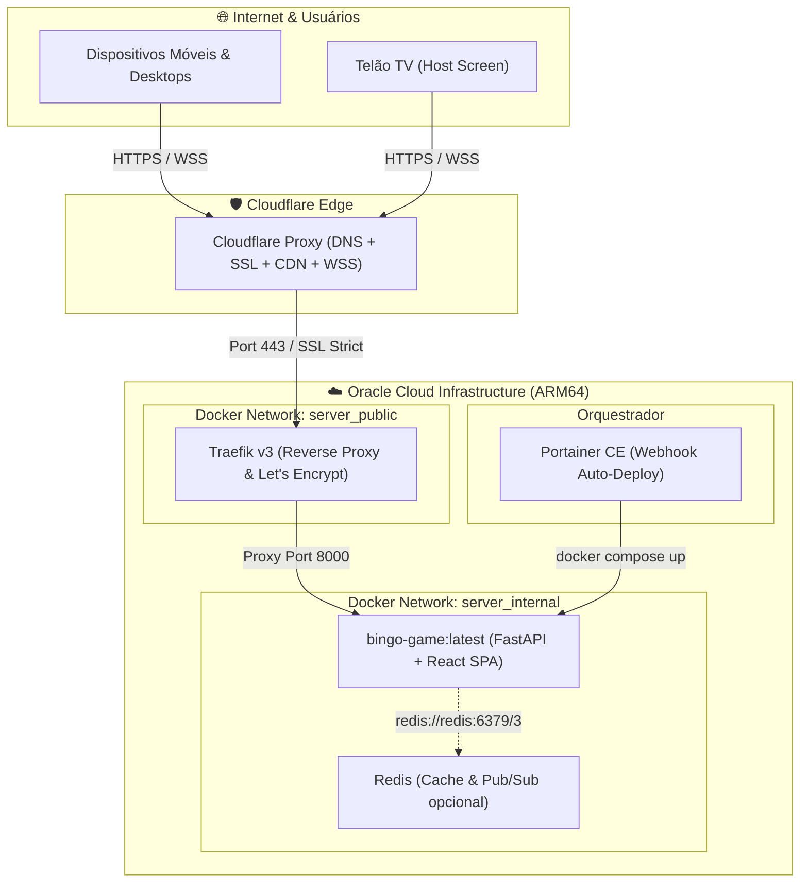
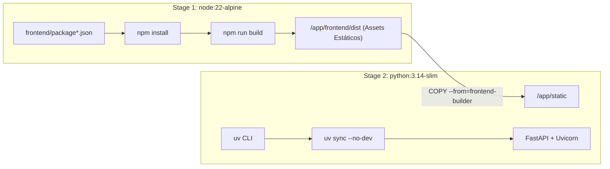
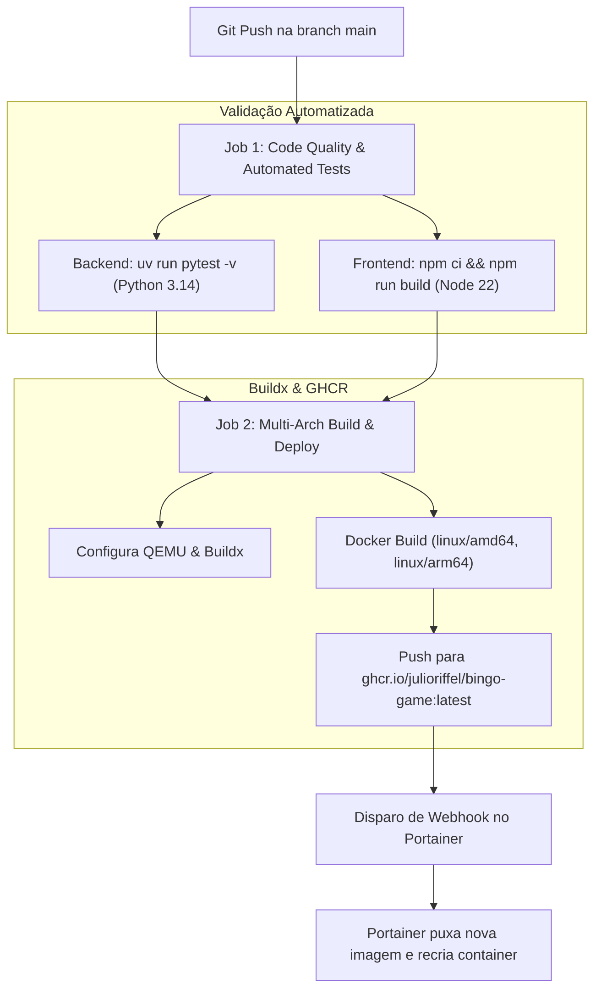

# 🖥️ Servidor, Infraestrutura & Deploy — Bingo Royale 75

Este documento detalha a topologia de infraestrutura, configuração do proxy reverso Traefik, containerização Docker multi-arquitetura e o pipeline de CI/CD automatizado para o ambiente de produção.

---

## 1. Topologia de Produção

O sistema está implantado em uma instância dedicada na nuvem **Oracle Cloud Infrastructure (OCI)**:



### Especificações do Servidor Host
- **Provedor:** Oracle Cloud Infrastructure (OCI) — Always Free Ampere A1 Compute
- **Arquitetura de CPU:** ARM64 (aarch64) — 4 OCPUs (Neoverse-N1)
- **Memória RAM:** 24 GB
- **Sistema Operacional:** Ubuntu Linux LTS
- **IP Público:** `168.138.247.93`
- **Acesso SSH:** `ssh -i ~/.ssh/oracle ubuntu@168.138.247.93`
- **Domínio Oficial:** [`https://bingo.bolsadedados.com.br`](https://bingo.bolsadedados.com.br)

---

## 2. Configuração do Traefik v3 (Proxy Reverso & SSL)

O roteamento e terminação TLS são administrados pelo Traefik v3 através de labels no `docker-compose.yaml`:

```yaml
labels:
  - "traefik.enable=true"
  - "traefik.docker.network=server_public"

  # Roteamento HTTP (Porta 80) -> Redirecionamento 301 para HTTPS
  - "traefik.http.routers.bingo-http.rule=Host(`bingo.bolsadedados.com.br`)"
  - "traefik.http.routers.bingo-http.entrypoints=web"
  - "traefik.http.routers.bingo-http.middlewares=bingo-redirect-https"
  - "traefik.http.middlewares.bingo-redirect-https.redirectscheme.scheme=https"
  - "traefik.http.middlewares.bingo-redirect-https.redirectscheme.permanent=true"

  # Roteamento HTTPS (Porta 443) -> Certificado SSL Let's Encrypt
  - "traefik.http.routers.bingo.rule=Host(`bingo.bolsadedados.com.br`)"
  - "traefik.http.routers.bingo.entrypoints=websecure"
  - "traefik.http.routers.bingo.tls.certresolver=letsencrypt"
  - "traefik.http.services.bingo.loadbalancer.server.port=8000"
```

### Redes Docker
- `server_public` (externa): conecta o Traefik ao contêiner para receber o tráfego da internet.
- `server_internal` (externa): rede isolada para comunicação com outros serviços locais (como Redis).

---

## 3. Containerização Multi-Stage (`Dockerfile`)

A aplicação utiliza um único contêiner ultra-otimizado com build em dois estágios:



### Principais Destaques do Dockerfile:
1. **Frontend Builder (`node:22-alpine`):** Compila o código TypeScript do React 19 com Vite gerando os bundles minificados em `/app/frontend/dist`.
2. **Runtime Python (`python:3.14-slim`):**
   - Utiliza a versão mais recente do Python (**3.14**).
   - Instala as dependências de produção via gerenciador de alta velocidade **`uv`** (`uv sync --no-dev`).
   - Copia o diretório compilado do React diretamente para `/app/static`.
   - O FastAPI serve os arquivos estáticos e entrega a SPA no fallback de rotas não pertencentes à API REST ou WebSockets.

---

## 4. Pipeline de CI/CD (GitHub Actions Multi-Arch)

O pipeline em `.github/workflows/ci-cd.yml` é disparado automaticamente a cada push na branch **`main`**:



### Passos do Pipeline:
1. **Validação de Qualidade e Testes:**
   - Instala o Python 3.14 e o `uv`.
   - Executa a suite completa de testes unitários e de integração (`uv run pytest -v`).
   - Instala o Node.js 22 e testa a compilação do frontend TypeScript (`npm run build`).
2. **Build Multi-Arquitetura:**
   - Habilita suporte a emulação ARM64 via `docker/setup-qemu-action@v3`.
   - Compila a imagem para as duas arquiteturas: `linux/amd64` e `linux/arm64`.
   - Publica os pacotes no **GitHub Container Registry (GHCR)**:
     - `ghcr.io/julioriffel/bingo-game:latest`
     - `ghcr.io/julioriffel/bingo-game:<commit_sha>`
3. **Disparo do Portainer Webhook:**
   - Faz uma requisição `POST` com `curl` ao endpoint seguro do Portainer configurado em `PORTAINER_BINGO_WEBHOOK_URL`.
   - O Portainer baixa a imagem atualizada e recria o contêiner instantaneamente com **zero downtime**.

---

## 5. Procedimento de Deploy Manual / Rollback

Caso seja necessário atualizar ou reiniciar a aplicação diretamente pelo terminal do servidor, utilize o script [`deploy.sh`](file:///home/julio/projects/bingo-game/deploy.sh):

```bash
# Conectar no servidor de produção
ssh -i ~/.ssh/oracle ubuntu@168.138.247.93

# Acessar diretório da stack
cd /home/ubuntu/bingo  # ou diretório configurado

# Executar script de deploy rápido
./deploy.sh
```

Conteúdo de execução do script:
```bash
docker compose -p bingo-game -f docker-compose.yaml pull
docker compose -p bingo-game -f docker-compose.yaml up -d --force-recreate
docker ps --filter "name=bingo-game"
```

---

## 6. Variáveis de Ambiente e Configuração

As variáveis podem ser definidas no arquivo `.env` do diretório do projeto ou na aba *Environment Variables* da Stack do Portainer:

| Variável | Padrão | Descrição |
| :--- | :--- | :--- |
| `PORT` | `8000` | Porta interna em que o Uvicorn escuta conexões. |
| `HOST` | `0.0.0.0` | Interface de rede de ligação do servidor ASGI. |
| `BINGO_DOMAIN` | `bingo.bolsadedados.com.br` | Hostname roteado pelo Traefik para emissão de SSL. |
| `BINGO_IMAGE_TAG` | `latest` | Tag da imagem do contêiner no GHCR. |
| `USE_REDIS` | `true` | Habilita suporte opcional a Redis para persistência. |
| `REDIS_URL` | `redis://redis:6379/3` | URL de conexão da instância interna do Redis. |
| `SECRET_KEY` | *(chave secreta)* | Segredo criptográfico usado para gerar as assinaturas HMAC das cartelas. |
| `BINGO_DATA_PATH` | `/home/ubuntu/bingo/data` | Volume persistente do host montado em `/app/data`. |
